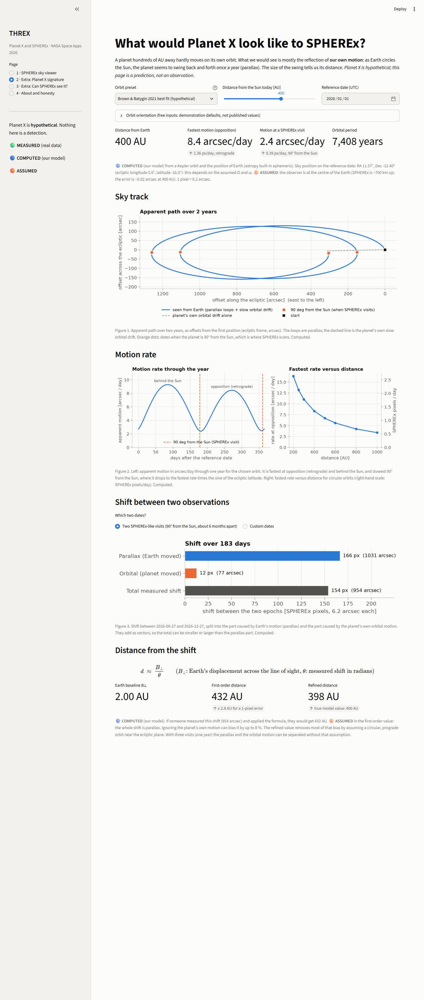
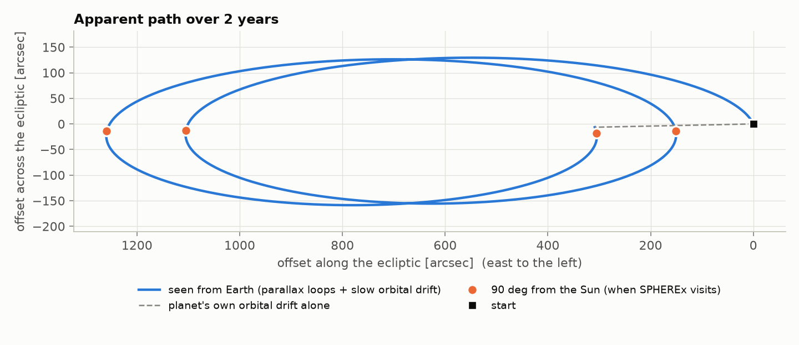
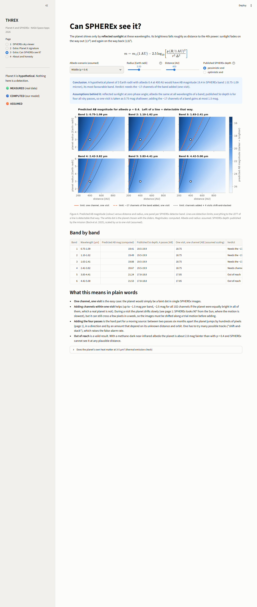
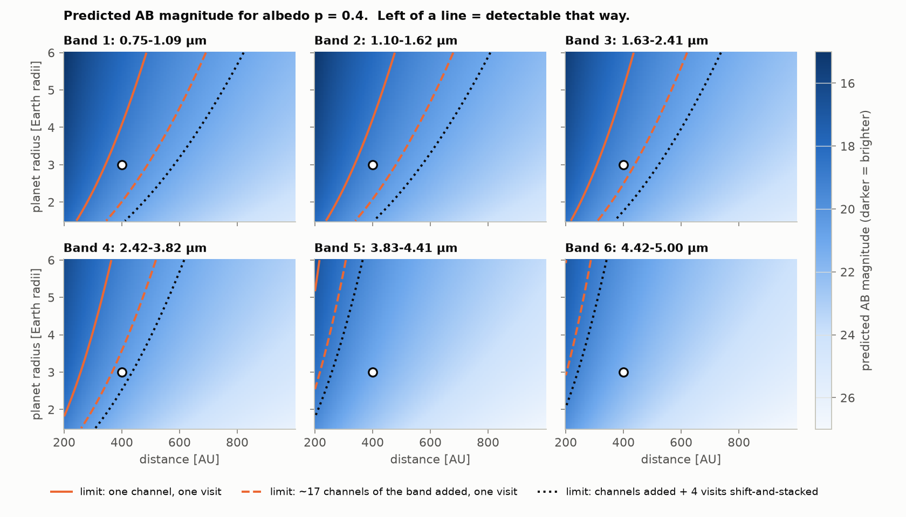
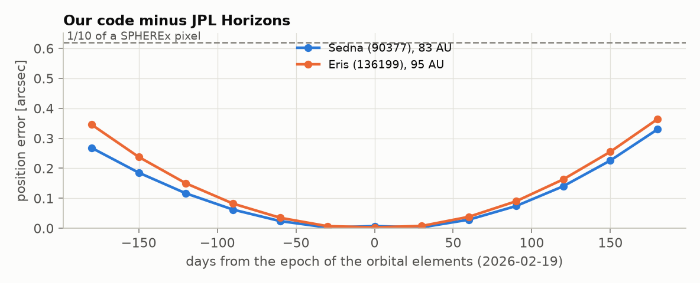
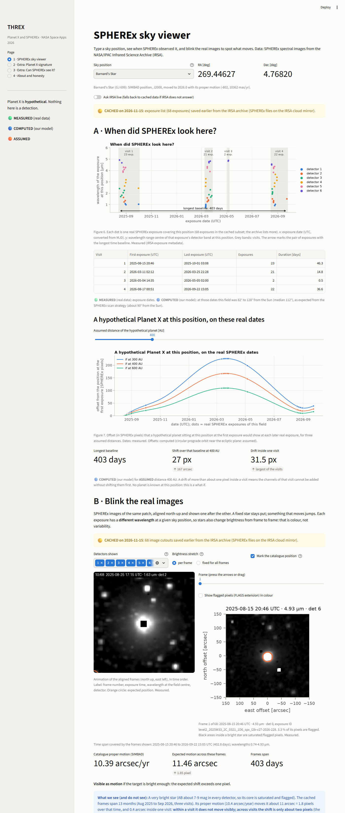
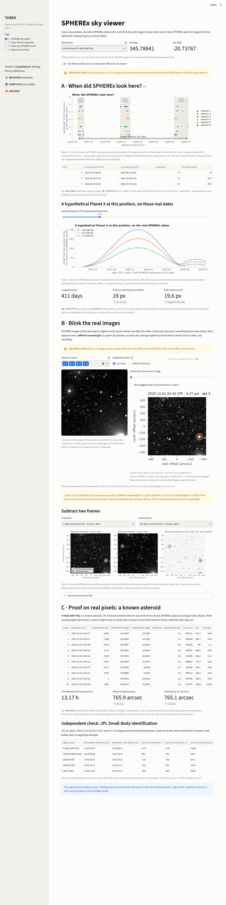
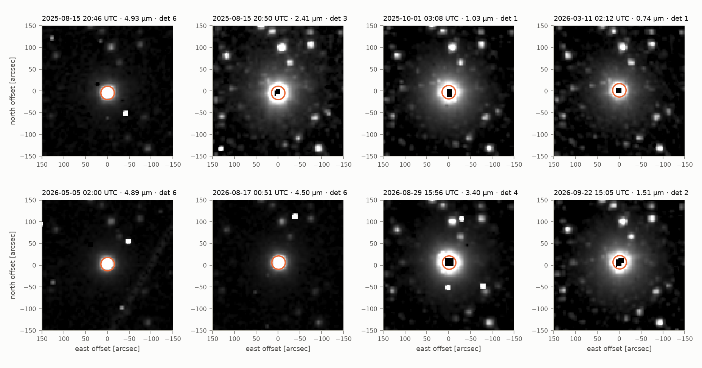
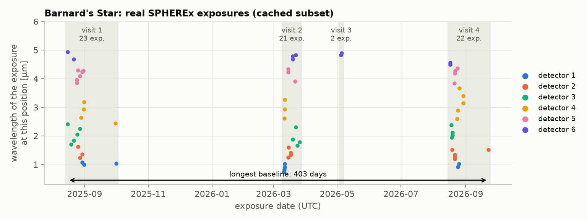
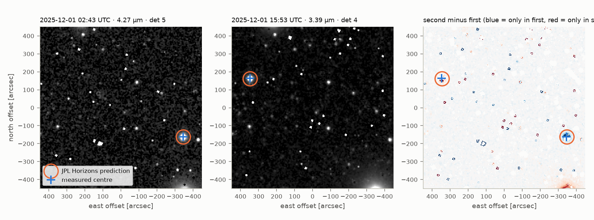

# THREX: what would Planet X look like to SPHEREx, and could SPHEREx see it?
> Challenge text read on 2026-11-15; framing to be double-checked by the team (see `DECISIONS.md` D0).

NASA Space Apps Challenge 2026, challenge
["Planet X and SPHEREx"](https://www.spaceappschallenge.org/2026/challenges/planet-x-and-spherex/).

> **Planet X / Planet Nine is hypothetical.** THREX predicts what such a planet would look
> like in SPHEREx data and shows real SPHEREx images so that moving objects can be spotted.
> It reports **no detection and no discovery**.

Every statement in this project is one of three kinds:
🟢 **MEASURED** (real data), 🔵 **COMPUTED** (our model), 🟠 **ASSUMED** (an input nobody knows).

## 1. The problem

SPHEREx maps the whole sky about every six months in 102 near-infrared colours. Things that
are close to us (asteroids, comets, nearby stars, brown dwarfs, and perhaps an unseen planet far
beyond Neptune) give themselves away by **changing position between images**. The challenge
asks for a public web tool that shows SPHEREx images of any sky position over time so that
people can spot what moves.

Looking is easier when you know what to look for. So THREX does two things:

1. **A viewer for real SPHEREx images** (page 3 of the app): type RA/Dec, see when SPHEREx
   observed that position, and play the aligned images as a time-lapse.
2. **A physics model of the target** (pages 1 and 2): how far and how fast would a
   hypothetical Planet X move between SPHEREx visits, how bright would it be, and is that
   bright enough?

## 2. Approach

| Part | Question | How |
|---|---|---|
| A. Signature | How does a planet at 300-1000 AU appear to move? | Kepler orbit + position of Earth; split into parallax and orbital motion |
| B. Detectability | Is it bright enough for SPHEREx? | Reflected sunlight versus the published SPHEREx depth |
| C. Real schedule | When did SPHEREx really look at a position? | IRSA SIA2 exposure metadata |
| D. Real-data proof | Does "blink and subtract" catch a real mover? | A known asteroid in SPHEREx cutouts, checked against JPL Horizons and sb_ident |

## 3. The physics in plain words

**Why a distant planet seems to move (parallax).** Hold a finger in front of your face and
close one eye, then the other: the finger jumps against the background. Earth does the same
thing by moving around the Sun. Six months apart, Earth is on opposite sides of its orbit,
2 AU apart. A planet at distance *d* then appears shifted by an angle of about 2 AU / *d*.
At 400 AU that is 2/400 rad ≈ 0.29° ≈ 1000 arcsec ≈ 170 SPHEREx pixels (one pixel is
6.2 arcsec). The planet's own orbital motion in the same six months is only about 80 arcsec,
because its orbit takes thousands of years. So the shift is mostly parallax, and
**measuring the shift measures the distance**: *d* ≈ *B*⊥ / θ, where *B*⊥ is how far Earth
moved across the line of sight and θ is the shift in radians.

**How fast it moves.** The apparent speed is fastest at opposition (planet opposite the
Sun), about 8 arcsec/day at 400 AU, and it is retrograde (westward). SPHEREx, however, scans
along a circle about 90° from the Sun. There, Earth moves mostly towards or away from the
planet, so the apparent motion is at its slowest: the opposition rate times the sine of the
planet's ecliptic latitude (2.4 arcsec/day for our 16°-inclined demo orbit, nearly zero for a
planet exactly on the ecliptic). Two consecutive SPHEREx visits are six months apart and sit
at the two ends of the parallax swing, which is the best case for measuring the shift.

**How bright it is.** The planet only reflects sunlight. Sunlight weakens as 1/*r*² on the
way out and the reflected light weakens as 1/Δ² on the way back, so brightness falls as
1/(*r*²Δ²): twice as far is 16 times fainter (3 magnitudes).

    m = m_sun(1 AU) - 2.5 log10[ p (R / 1 AU)^2 / (r^2 Δ^2) ]

with *p* the geometric albedo (fraction of light reflected back), *R* the radius, *r* and Δ
the distances to the Sun and to Earth in AU. For Δ = *r* = 400 AU, *R* = 3 Earth radii,
*p* = 0.4 this gives *m* = 19.7 in visible light.

**Its own heat does not help.** At 10-50 K a blackbody emits essentially nothing at 3-5 µm
(more than 30 magnitudes below the reflected light). Real atmospheres are not blackbodies
(see Limitations).

## 4. Data used

| Data | Kind | Source |
|---|---|---|
| SPHEREx spectral images (Level 2), cutouts and exposure metadata | 🟢 measured | NASA/IPAC Infrared Science Archive (IRSA): [data access guide](https://caltech-ipac.github.io/spherex-archive-documentation/spherex-data-access), SIA2 collections `spherex_dr1`, `spherex_qr3`; [cutout service](https://irsa.ipac.caltech.edu/ibe/cutouts.html); [tutorial](https://caltech-ipac.github.io/irsa-tutorials/spherex-intro) |
| Positions and orbital elements of Sedna, Eris and the proof asteroid | 🟢 measured/ephemeris | [JPL Horizons API](https://ssd-api.jpl.nasa.gov/doc/horizons.html) |
| Known small bodies in a field; asteroid facts | 🟢 | [JPL sb_ident](https://ssd-api.jpl.nasa.gov/doc/sb_ident.html), [JPL SBDB](https://ssd-api.jpl.nasa.gov/doc/sbdb.html) |
| SPHEREx depth, pixel scale, bands | 🟢 published | Bock et al. 2025, [arXiv:2511.02985](https://arxiv.org/abs/2511.02985); [survey page](https://spherex.caltech.edu/page/survey) |
| Planet Nine orbit (a = 380 AU, q = 300 AU, i = 16°, 6.2 Earth masses) | hypothesis | Brown & Batygin 2021, [arXiv:2108.09868](https://arxiv.org/abs/2108.09868) |
| Sun's AB magnitudes in standard filters | 🟢 tabulated | Willmer 2018, ApJS 236, 47, [online table](http://mips.as.arizona.edu/~cnaw/sun.html) |
| Earth and Sun positions | 🔵 | astropy built-in ephemeris (no download) |

Cached copies of the real data used by the app are in [`data_cache/`](data_cache/README.md).

## 5. How to run

```bash
python -m venv .venv
.venv\Scripts\activate            # Windows   (Linux/macOS: source .venv/bin/activate)
pip install -r requirements.txt
streamlit run app.py
```

Tests (offline; they use cached JPL data):

```bash
pip install -r requirements-dev.txt
pytest
```

Other commands:

```bash
python scripts/sanity_checks.py              # the back-of-envelope numbers of section 3
python scripts/check_environment.py          # can every compiled library be loaded?
python scripts/make_figures.py               # regenerate the PNG figures in screenshots/
python scripts/fetch_horizons_validation.py  # refresh the JPL Horizons test data
python scripts/build_viewer_cache.py Barnard # rebuild one target's cache (needs IRSA; pip install -r requirements-build.txt)
python scripts/check_links.py                # do all README links exist?
```

Tested with Python 3.14 on Windows 11. **Windows note:** on a machine with "Smart App
Control / Application Control", the very first import of a freshly installed compiled library
(scipy, `astropy.wcs`) can fail with *"An Application Control policy has blocked this file"*.
Running the same command a second time worked on our machine. `python
scripts/check_environment.py` shows what loads.

The viewer accepts coordinates in the URL: `http://localhost:8501/?ra=133.795&dec=-7.245`.

## 6. Results

### 6.1 Signature of a hypothetical Planet X (🔵 computed)

Brown & Batygin (2021) best-fit orbit, planet placed at 400 AU, demo orientation:

| Quantity | Value |
|---|---|
| Parallax shift between two visits six months apart | 1031 arcsec = 166 SPHEREx pixels |
| Planet's own orbital motion in that time | 77-81 arcsec = 12-13 pixels |
| Total shift an observer measures (the two partly cancel around opposition) | about 950 arcsec = 153 pixels |
| Fastest apparent motion (opposition, retrograde) | 8.3-8.4 arcsec/day = 0.35 arcsec/hour = 1.35 pixels/day |
| Apparent motion at a SPHEREx visit (90° from the Sun), 16° ecliptic latitude | 2.4 arcsec/day = 0.39 pixels/day |
| Distance recovered from the simulated shift | 434 AU first order (± 2.8 AU for a 1-pixel error, up to 8 % bias from ignoring orbital motion); 400 AU with the refined estimate |


*Screenshot of the running app.*


*Apparent path over two years (offsets in arcsec). Loops: parallax. Dashed: the planet's own
drift. Orange: dates when SPHEREx would visit. Computed.*

### 6.2 Could SPHEREx see it? (🔵 computed from 🟠 assumed albedo and radius)

SPHEREx 5σ depth per spectral channel after four all-sky passes (🟢 published): 19.5-19.9 AB at
0.75-3.8 µm, 17.8-18.8 AB at 3.8-5.0 µm.

For 3 Earth radii, albedo 0.4, 400 AU the model gives AB 19.4 in band 1 (0.75-1.09 µm), 19.5
in band 2, 19.9 in band 3, 20.7 in band 4 and 21.2-21.5 in bands 5-6. In plain words:

- **Not visible in a single channel of a single visit**: the limit is about 18.7 AB (one
  visit is taken as 0.75 mag shallower than the four-pass depth: our assumption).
- **Within reach in bands 1-3 after adding the ~17 channels of a band within one visit**
  (limit about 20.3 AB, gain up to 1.5 mag), but only if the planet really is that reflective
  in the near infrared, and only after shifting the images along a trial motion.
- **Combining the four passes** would add another 0.75 mag, but requires shift-and-stack
  because the planet jumps ~150 pixels between passes.
- **Out of reach beyond about 3.8 µm**, where the Sun is fainter and SPHEREx is less deep.
- **Out of reach everywhere if the near-infrared albedo is methane-dark** (p ≈ 0.03 makes
  the planet 2.8 mag fainter), or if the planet is smaller or farther (each factor 1.26 in
  distance costs 1 magnitude).

A "not detectable" answer is a valid result: SPHEREx was not built to find Planet X, and
a clear statement of where its limit lies is the honest outcome.


*Screenshot of the running app.*


*Predicted AB magnitude versus distance and radius for albedo 0.4, one panel per SPHEREx
detector band. Left of a line = detectable that way. White dot: 400 AU, 3 Earth radii.*

### 6.3 Validation against JPL Horizons (🟢 measured vs 🔵 computed)

Using the osculating elements of two real distant bodies at one epoch (2026-02-19) and our
Kepler + parallax code, compared with Horizons geocentric astrometric positions on 13 dates
spanning ±180 days (data downloaded 2026-11-15):

| Body | Distance | Max position error | Max rate error | Max 180-day shift error |
|---|---|---|---|---|
| Sedna (90377) | 83 AU | 0.33 arcsec | 0.0002 arcsec/hour | 0.007 % |
| Eris (136199) | 95.5 AU | 0.36 arcsec | 0.0002 arcsec/hour | 0.010 % |

Stated tolerance in the tests: 1 arcsec (0.16 pixel). The residual grows with time from the
epoch because we keep a fixed two-body orbit and ignore the giant planets.



### 6.4 Real SPHEREx data

Real SPHEREx pixels are in the app (front page) and cached in `data_cache/` (about 25 MB).

| Target (SIMBAD position + proper motion) | Cached frames (of exposures listed by IRSA) | Dates covered | What we see |
|---|---|---|---|
| Barnard's Star | 68 of 358 | 2025-08-15 to 2026-09-22 (several visits) | Very bright, core saturated. Proper motion 10.4 arcsec/yr = about 1.8 pixels over the span, 0.4 arcsec inside one visit: **not visible by eye**. |
| Epsilon Indi B | 69 of 458 | 2025-04-24 to 2026-10-02 | Pair of brown dwarfs detected, not resolved. Motion (4.7 arcsec/yr) about 1.1 pixel over the span: not visible by eye. |
| WISE 0855-0714 | 69 of 258 | 2025-05-05 to 2026-05-14 | WISE 0855-0714 is extremely faint below about 1.6 micron (Hubble photometry in Vega magnitudes: 26.31 +/- 0.10 at 1.153 micron and 23.22 +/- 0.35 at 1.575 micron; Luhman and Esplin 2016, arXiv:1605.08620), far below SPHEREx's ~19.5 AB single-band depth, so a source measured near its position at those wavelengths is most likely a background blend and we claim no detection. |
| RW Aurigae | 66 of 335 | 2025-09-01 to 2026-09-16 | Bright star; variability cannot be judged because the wavelength changes frame to frame. |
| R Draconis | 61 of 539 | 2025-05-16 to 2026-07-14 | Saturated in most short-wavelength frames; its variability was not analysed. |

Frames are an even-in-time subset of what the archive lists (to keep the cache under 30 MB), minus a few where the target is
within 30 pixels of the detector edge. Pixels were read with HTTP range requests from IRSA's public cloud mirror (AWS bucket
`nasa-irsa-spherex`); the exposure lists come from IRSA's SIA2 search. The S/N values shown in the app come from simple
aperture photometry with a noise estimate from the sky ring; they are rough and not independently calibrated.

**Proof on a known asteroid:** 6 Hebe, 2025-12-01. JPL Horizons predicts its position in each frame; two groups of
frames 13.2 hours apart show it at the predicted places. Measured displacement 765.9 arcsec, predicted 765.1 arcsec
(offsets from the predicted centre 0.3-1.9 arcsec per frame). JPL sb_ident lists 6 Hebe among 5 known bodies in the
field. The asteroid is bright enough to saturate the detector, so its fluxes are not reliable. It was already known:
nothing was discovered.


*Screenshot of the running app.*


*Screenshot of the running app.*


*Barnard's Star at eight dates and wavelengths (north up, east left); orange circle: SIMBAD position.*




*6 Hebe at the first and last frame, 13.2 hours apart; orange circle: JPL Horizons prediction; blue cross: our measured centre.*

## 7. Limitations (please read)

**Honest summary of what the data do and do not show**
- Frames are an evenly spaced subset of the exposures IRSA lists for each position: Barnard's Star 68 of 358, Epsilon Indi B 69 of 458, WISE 0855-0714 69 of 258, RW Aurigae 66 of 335, R Draconis 61 of 539.
- R Draconis is saturated in most short-wavelength frames and its variability was not analysed.
- 6 Hebe saturates the detector, so only its positions are meaningful (766 arcsec measured vs 765 arcsec predicted by Horizons, 13.2 hours apart); its fluxes are not.
- Proper motions shown are catalogue (SIMBAD) values, not measured by us.
- Photometry (S/N, AB values) is rough, from a simple aperture, and not independently calibrated.
- Custom RA/Dec queries work only when IRSA's search answers; presets use cached data.
- Assumptions, not facts: the one-visit depth is 0.75 mag shallower than the four-pass depth; the "methane-dark" albedo 0.03; the demonstration values of the orbit angles Omega (100 deg) and omega (150 deg); radius and albedo of Planet X.
- Planet X is hypothetical. No detection is claimed for anything.


- **Planet X is hypothetical.** Its orbit orientation (Ω, ω), position on the orbit, radius
  and albedo are unknown; in the app they are sliders with labelled demonstration defaults.
- **Observer at the centre of the Earth**, not at the SPHEREx spacecraft (~700 km altitude).
  Negligible at 400 AU (0.02 arcsec), but up to a few arcsec for a main-belt asteroid.
- **Two-body orbits**, no planetary perturbations (validated to 0.4 arcsec over ±180 days).
- **Brightness model**: reflected light at zero phase, one albedo per band, no methane bands
  resolved. The "methane-dark" albedo of 0.03 is illustrative, not fitted. Fortney et al.
  (2016) argue a cold Planet Nine could instead be bright and blue (visible albedo up to
  ~0.75) and that its 3-5 µm thermal flux could be far above a blackbody; we model neither.
- **Depth scaling**: "one visit is 0.75 mag shallower" and "adding K channels gains
  2.5 log10 √K" are simple square-root-of-N assumptions, not mission numbers. Source
  confusion (many stars per 6.2 arcsec pixel near the Galactic plane) is ignored.
- **Viewer**: frames taken at different times have different wavelengths at a given sky
  position, so stars change brightness between frames and do not cancel perfectly in a
  difference image. Alignment is bilinear resampling to a north-up grid; photometry is a
  simple aperture sum without aperture correction.
- **No automated search** was run on SPHEREx data and nothing new was found.

## 8. Repository layout

```
threx/            orbits.py observer.py signature.py photometry.py detectability.py
                  spherex_io.py blink.py jpl.py validation.py plots.py targets.py constants.py
app.py            Streamlit app (pages 1, 2, 4)      app_realdata.py   page 3
tests/            pytest suite (+ tests/data: real JPL Horizons output)
scripts/          sanity checks, figure and cache builders
data_cache/       small cached real results (see its README)
screenshots/      PNG figures for the submission
DECISIONS.md      every decision taken during the build, with reasons
AI_USE.md         how AI was used        form_text.md  SUBMIT_CHECKLIST.md
slides/           threx_deck.pdf (7 slides)
```

## 9. References

1. Bock, J. J. et al. 2025, "The SPHEREx Satellite Mission", arXiv:2511.02985 (accepted by ApJ).
2. Brown, M. E. & Batygin, K. 2021, "The orbit of Planet Nine", AJ 162, 219, arXiv:2108.09868.
3. Fortney, J. J. et al. 2016, "The Hunt for Planet Nine: Atmosphere, Spectra, Evolution, and
   Detectability", ApJL 824, L25, arXiv:1604.07424.
4. Luhman, K. L. & Esplin, T. L. 2016, arXiv:1605.08620.
5. Willmer, C. N. A. 2018, "The Absolute Magnitude of the Sun in Several Filters", ApJS 236, 47.
6. SPHEREx Archive at IRSA, User Guide: https://caltech-ipac.github.io/spherex-archive-documentation/
7. IRSA SPHEREx tutorial notebooks: https://caltech-ipac.github.io/irsa-tutorials/spherex-intro
8. JPL Solar System Dynamics APIs: https://ssd-api.jpl.nasa.gov/
9. Astropy Collaboration 2022, ApJ 935, 167; Ginsburg et al. 2019, AJ 157, 98 (astroquery).

## 10. Licence and use of AI

Code: MIT (see `LICENSE`). SPHEREx data: NASA/IPAC Infrared Science Archive.

Yes, AI tools were used. The team member (Kabil Gannouni) chose the challenge and approved the project concept, which was developed with Claude (Anthropic) in a chat. Claude Code (Anthropic's coding agent) wrote the Python code, the automated tests, the Streamlit app and the first drafts of the documentation and slides, and it queried and processed the public NASA/IPAC SPHEREx and JPL data described in this submission. The team member directed the work and is responsible for all content. All data shown are real SPHEREx and JPL data; synthetic images exist only inside automated tests and are labelled as such.
